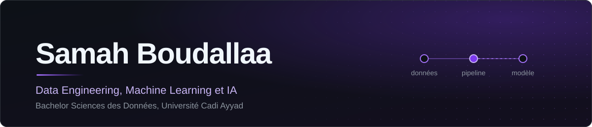
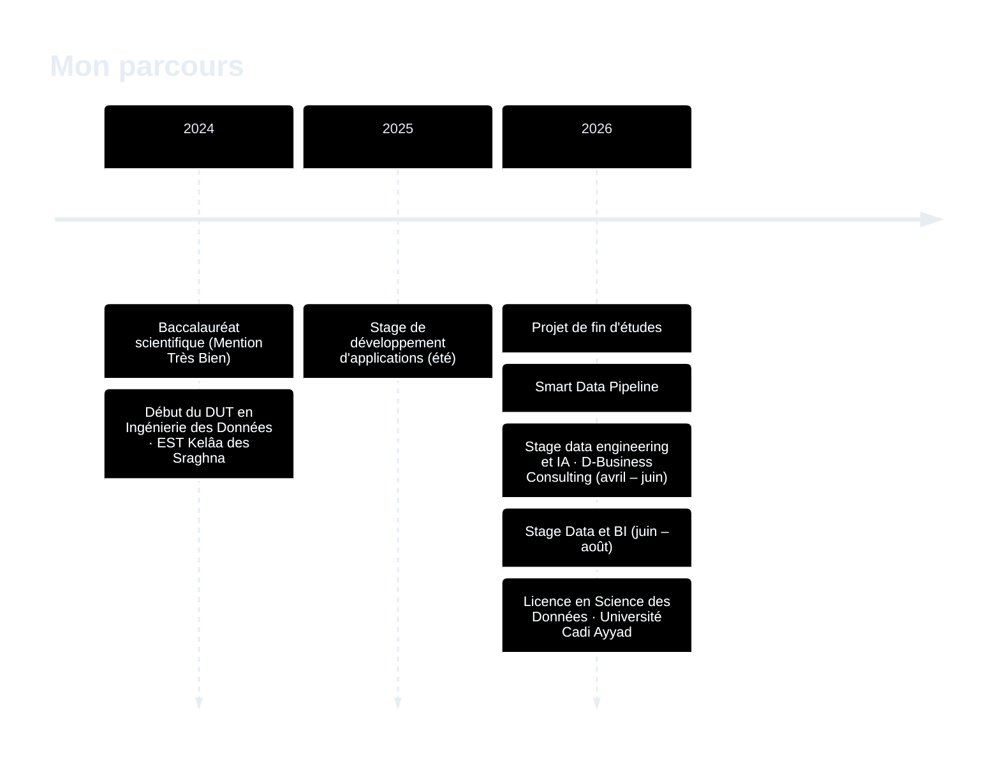

<p align="right"><a href="./README.md"></a><a href="./README.fr.md"></a></p>



<div align="center">

<br/>

<b>Étudiante en Science des Données · Data Engineering, Machine Learning et IA</b><br/>
<sub>Maroc · à la recherche de stages en data engineering, machine learning et IA</sub>

<br/><br/>


<a href="https://github.com/Samah-boudallaa/Samah-boudallaa/releases/download/cv-v1.0/CV_SAMAH_BOUDALLAA_FR.pdf">
  
</a>
<br/><br/>

<sub><a href="#projets">Projets</a> &nbsp;·&nbsp; <a href="#architectures">Architectures</a> &nbsp;·&nbsp; <a href="#stack-technique">Stack</a> &nbsp;·&nbsp; <a href="#activité-github">Activité</a> &nbsp;·&nbsp; <a href="#parcours">Parcours</a> &nbsp;·&nbsp; <a href="#contact">Contact</a></sub>

</div>

<br/>

## En 30 secondes

Étudiante en Licence **Science des Données** à l'EST de Kelâa des Sraghna (Université Cadi Ayyad), après un **DUT en Ingénierie des Données**. Je m'intéresse au **data engineering**, au **machine learning**, à l'**IA** et à l'**industrialisation des pipelines de données**.

> De la donnée brute au modèle servi par une API, avec tests, conteneurs et supervision.

<table>
<tr>
<td valign="top" width="33%">
<b>Ce que je recherche</b><br/>
Un stage en <b>data engineering</b>, <b>machine learning</b> ou <b>IA</b>, où la donnée arrive réellement en production.
</td>
<td valign="top" width="33%">
<b>Ce que j'apporte</b><br/>
Pipelines streaming et batch, APIs, tests, CI et conteneurs : le tout <b>reproductible</b>.
</td>
<td valign="top" width="33%">
<b>À vérifier par vous-même</b><br/>
Chaque projet ci-dessous a un dépôt public, un schéma d'architecture et des chiffres issus de tests locaux.
</td>
</tr>
</table>

<br/>

<div align="center">

</div>

<br/>

## Projets

<table>
<tr>
<td valign="top" width="46%">

<h3>Smart Data Pipeline</h3>
<b>Pipeline IoT temps réel avec traitement adaptatif et supervision</b>
<br/><sub>Projet de fin d'études DUT · équipe de trois · 2026</sub>

<br/><br/>
<code>Python</code> <code>Kafka</code> <code>Spark</code> <code>Pandas</code> <code>Isolation Forest</code> <code>Prometheus</code> <code>Grafana</code> <code>Docker Compose</code>

<br/><br/>
<b><a href="https://github.com/Samah-boudallaa/smart-data-pipeline-pfe">Voir le dépôt</a></b>
<br/>


</td>
<td valign="top" width="54%">

<b>Résultats clés (tests locaux)</b>
<ul>
<li>Environ <b>132 000</b> mesures simulées dans le flux</li>
<li><b>8</b> métriques de supervision Prometheus</li>
<li><b>6</b> conteneurs orchestrés avec Docker Compose</li>
<li>Latence inférieure à <b>500 ms</b> par message</li>
<li>Plus de <b>28 400</b> messages traités sans perte</li>
</ul>

</td>
</tr>
</table>

<br/>

<table>
<tr>
<td valign="top" width="46%">

<h3>NexaDecide</h3>
<b>Plateforme d'aide à la décision alliant data engineering et IA</b>
<br/><sub>Stage chez D-Business Consulting · avril – juin 2026</sub>

<br/><br/>
<code>Python</code> <code>FastAPI</code> <code>Streamlit</code> <code>DuckDB</code> <code>Parquet</code> <code>XGBoost</code> <code>LangChain</code> <code>Mistral AI</code>

<br/><br/>
<b><a href="https://github.com/Samah-boudallaa/nexadecide-decision-system">Voir le dépôt</a></b>
<br/>


</td>
<td valign="top" width="54%">

<b>Résultats clés (conditions de test)</b>
<ul>
<li><b>443 154</b> enregistrements traités par le pipeline ETL</li>
<li>Lecture du cache en <b>moins de 100 ms</b> (contre 15 à 30 s directement sur SQL Server)</li>
<li><b>9</b> endpoints FastAPI et <b>10</b> pages Streamlit</li>
<li>Prévision du chiffre d'affaires : <b>8,9 % de MAPE</b> (XGBoost, données simulées)</li>
<li>Recommandations avec Mistral AI, LangChain et RAG</li>
<li>Intégration Odoo CRM via XML-RPC (instance de test)</li>
</ul>

</td>
</tr>
</table>

<br/>

<table>
<tr>
<td valign="top" width="46%">

<h3>GraphGen</h3>
<b>Application web d'analyse exploratoire de fichiers CSV et Excel</b>
<br/><sub>Projet en binôme avec <a href="https://github.com/Chaymae-El-Bahloul">Chaymae El Bahloul</a></sub>

<br/><br/>
<code>Python</code> <code>Flask</code> <code>Pandas</code> <code>Plotly</code> <code>pytest</code> <code>ruff</code> <code>GitHub Actions</code> <code>Docker</code>

<br/><br/>
<b><a href="https://github.com/Samah-boudallaa/GraphGen">Voir le dépôt</a></b>
<br/>
<a href="https://github.com/Samah-boudallaa/GraphGen/actions/workflows/ci.yml"></a>

</td>
<td valign="top" width="54%">

<b>Résultats clés</b>
<ul>
<li>Visualisations interactives avec <b>Plotly</b></li>
<li><b>12</b> tests pytest</li>
<li>Linting avec ruff</li>
<li>Intégration continue via GitHub Actions</li>
<li>Conteneur Docker <b>non-root</b> avec healthcheck</li>
</ul>

</td>
</tr>
</table>

<sub><i>Note sur les résultats : les chiffres proviennent de tests locaux ou de données simulées. Ce ne sont pas des garanties de performance en production.</i></sub>

<br/>

<details>
<summary><b>Pourquoi ces projets ? Ce qu'ils montrent de ma façon de travailler</b></summary>

<br/>

| Projet | Compétence démontrée | Preuve dans le dépôt |
|---|---|---|
| **Smart Data Pipeline** | Concevoir un flux temps réel observable | Kafka, métriques Prometheus, dashboards Grafana, `docker-compose.yml` |
| **NexaDecide** | Relier données, modèles et usage métier | ETL, cache DuckDB/Parquet, API FastAPI, prévision, RAG |
| **GraphGen** | Livrer un logiciel propre et reproductible | tests pytest, ruff, CI GitHub Actions, image Docker non-root |

</details>

<br/>

## Architectures

<sub>Chaque schéma est accompagné d'une version texte, pour les lecteurs d'écran et les connexions lentes.</sub>

### Smart Data Pipeline

<div align="center">

</div>

<sub><b>Version texte :</b> mesures IoT simulées → Apache Kafka (KRaft) → moteur adaptatif (Pandas / Spark) → Isolation Forest (détection d'anomalies) → résultats de détection ; le moteur expose aussi des métriques Prometheus → supervision Grafana.</sub>

### NexaDecide

<div align="center">

</div>

<sub><b>Version texte :</b> SQL Server → pipeline ETL → cache analytique DuckDB / Parquet → API FastAPI → (prévision du chiffre d'affaires XGBoost · RAG avec LangChain et Mistral AI · interface Streamlit). L'API et une instance de test Odoo CRM échangent des données dans les deux sens via XML-RPC.</sub>

### GraphGen

<div align="center">

</div>

<sub><b>Version texte :</b> fichiers CSV / Excel → Flask + Pandas → analyse des données → visualisations Plotly. Branche qualité : Flask + Pandas → pytest et ruff → GitHub Actions ; le tout empaqueté dans une image Docker non-root.</sub>

<br/>

## Stack technique

| Domaine | Technologies |
|---|---|
| **Langages** |     |
| **Data Engineering** |         |
| **Machine Learning et IA** |       |
| **APIs et applications** |     |
| **Qualité et exploitation** |         |

<sub><i>Technologies utilisées dans des contextes variés, avec des niveaux de pratique différents.</i></sub>

<br/>

## Activité GitHub

Ce tableau de bord n'est pas un widget tiers : il est **généré chaque jour par mon propre pipeline** (script Python + GitHub Actions) à partir de l'API GitHub. Un pipeline de données, appliqué à mon propre profil.

<div align="center">


<sub><i>Une partie de mon travail de stage se trouve dans des dépôts privés : selon le jeton utilisé, elle est comptée à part ou absente de ces graphiques.<br/>La page de profil GitHub additionne, elle, les contributions publiques et privées.</i></sub>

</div>

<details>
<summary><b>Vue 3D des contributions</b></summary>

<br/>

<div align="center">

<br/>
<sub><i>Générée par GitHub Actions avec l'action open source github-profile-3d-contrib.</i></sub>
</div>

</details>

<details>
<summary><b>Comment ce tableau de bord est produit</b></summary>

<br/>

Rien n'est copié à la main : un workflow GitHub Actions interroge l'API GitHub (REST et GraphQL), un script Python calcule les indicateurs et écrit des fichiers SVG animés, et le résultat est commité automatiquement.

<div align="center">

</div>

<sub><b>Version texte :</b> exécution planifiée GitHub Actions → script Python (REST + GraphQL) → stats.svg animé ; la même exécution génère aussi la vue 3D des contributions ; les deux fichiers aboutissent dans le README du profil.</sub>

</details>

<br/>

## Parcours

| Période | Intitulé | Détails |
|---|---|---|
| **2026 – aujourd'hui** | **Licence en Science des Données** | EST Kelâa des Sraghna (Université Cadi Ayyad) |
| **2024 – 2026** | **DUT en Ingénierie des Données** | EST Kelâa des Sraghna |
| **2025 – 2026** | **Trois stages** | Développement d'applications (été 2025) · Data engineering et IA (avril – juin 2026) · Data et BI (juin – août 2026) |
| **2024** | **Baccalauréat scientifique** | Mention Très Bien |

<details>
<summary><b>Voir la chronologie</b></summary>



</details>

<br/>

## En cours d'exploration

<sub>Sujets que j'apprends activement, pas encore pratiqués en production.</sub>

- Suivi d'expériences et versionnement de modèles avec **MLflow**
- Détection de dérive des données et des modèles
- **CI/CD** appliquée au machine learning
- **Kubernetes**, Linux et Bash

<br/>

## Contact

<div align="center">

<b>Disponible pour des stages et opportunités en data engineering, machine learning et IA.</b><br/>
<sub>Le plus rapide pour me joindre : e-mail ou LinkedIn.</sub>

<br/><br/>

<a href="mailto:samahboudallaa@gmail.com?subject=Opportunit%C3%A9%20de%20stage"></a>
<a href="https://www.linkedin.com/in/samah-boudallaa-92409a329"></a>
<br/>
<a href="https://samah-boudallaa.github.io/"></a>
<a href="https://github.com/Samah-boudallaa"></a>

</div>

<br/>

<details>
<summary><sub>docker compose up -d</sub></summary>

<br/>

```bash
$ docker compose up -d
[+] Running 6/6
 Container kafka         Started
 Container spark         Started
 Container anomaly-ml    Started
 Container prometheus    Started
 Container grafana       Started
 Container samah         Started   # hire me
```

</details>

<br/>

<div align="center">


<br/>

Merci de votre visite. Une question, un projet, un stage : n'hésitez pas à me contacter.

<sub><a href="https://samah-boudallaa.github.io/">Portfolio</a> · <a href="https://www.linkedin.com/in/samah-boudallaa-92409a329">LinkedIn</a> · <a href="mailto:samahboudallaa@gmail.com">E-mail</a> · <a href="https://github.com/Samah-boudallaa">GitHub</a></sub>

<br/>

<a href="./README.md"></a><a href="./README.fr.md"></a>

</div>
