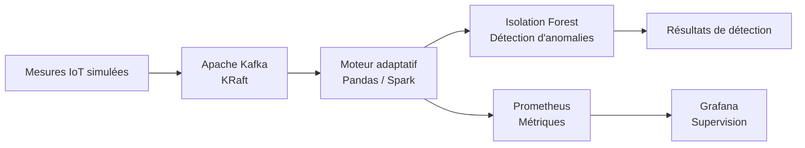
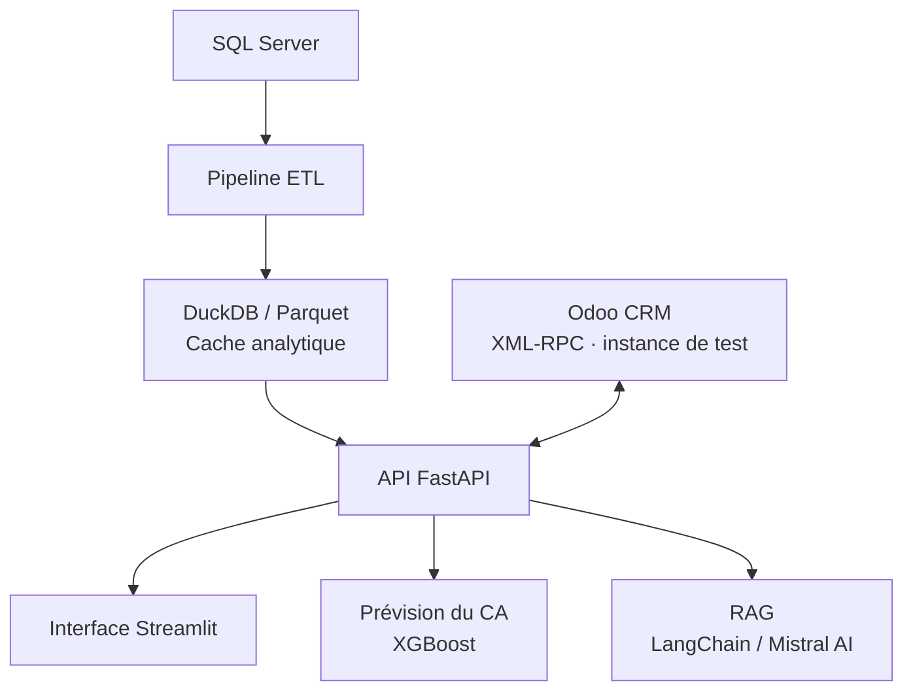
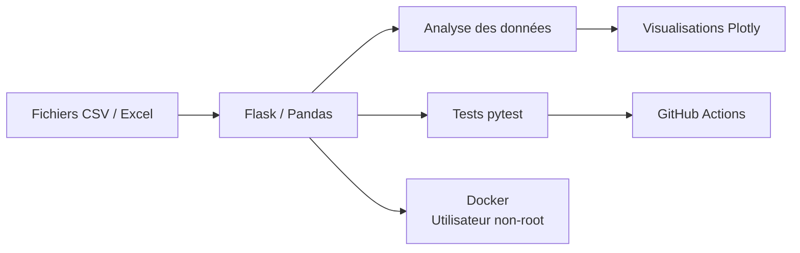

# Samah Boudallaa

**Bachelor Sciences des Données · Data Engineering · Machine Learning & IA**

Étudiante à l'Université Cadi Ayyad, je conçois des solutions de bout en bout, de l'ingestion des données au déploiement d'applications intégrant des modèles de machine learning. Je m'intéresse particulièrement aux pipelines fiables, à la qualité logicielle et à l'industrialisation des solutions data.

[Portfolio](https://samah-boudallaa.github.io/) · [LinkedIn](https://www.linkedin.com/in/samah-boudallaa-92409a329) · [E-mail](mailto:samahboudallaa@gmail.com)

---

## Parcours

- **2026 – En cours** · Bachelor Sciences des Données — EST Kelâa des Sraghna
- **2024 – 2026** · DUT Ingénierie des Données— EST Kelâa des Sraghna
- **2025 – 2026** · Trois stages en développement d'applications, data engineering et IA, et data & BI
- **2024** · Baccalauréat scientifique, mention Très Bien

## Stack technique

| Domaine | Technologies |
|---|---|
| **Langages** | Python, SQL, R, C |
| **Data Engineering** | Apache Kafka, Apache Spark, Pandas, ETL, DuckDB, Parquet, SQL Server, MySQL |
| **Machine Learning & IA** | Scikit-learn, XGBoost, Isolation Forest, RAG, LangChain, Mistral AI |
| **API & applications** | FastAPI, Flask, REST, Streamlit |
| **Qualité & exploitation** | Docker, Docker Compose, Git, GitHub Actions, pytest, ruff, Prometheus, Grafana |

*Technologies utilisées dans des contextes variés, avec des niveaux de pratique différents.*

---

## Projets principaux

### 01 · Smart Data Pipeline

**Pipeline IoT temps réel avec traitement adaptatif et supervision**

Projet de fin d'études du DUT, réalisé en équipe de trois (2026).

**Résultats des tests locaux**

- Environ **132 000 mesures simulées** dans le flux.
- **8 métriques** de supervision avec Prometheus.
- **6 conteneurs** orchestrés avec Docker Compose.
- Latence mesurée inférieure à **500 ms par message** et plus de **28 400 messages traités sans perte**, selon les tests réalisés.

**Stack :** Python · Kafka · Spark · Pandas · Isolation Forest · Prometheus · Grafana · Docker Compose

[Voir le dépôt →](https://github.com/Samah-boudallaa/smart-data-pipeline-pfe)

### 02 · NexaDecide

**Plateforme d'aide à la décision intégrant data engineering et IA**

Réalisée pendant mon stage chez D-Business Consulting (avril – juin 2026).

**Résultats et fonctionnalités**

- **443 154 enregistrements** traités par le pipeline ETL.
- Lecture du cache en **moins de 100 ms**, contre 15 à 30 secondes en interrogation directe de SQL Server, dans les conditions des tests réalisés.
- API FastAPI comprenant **9 endpoints** et interface Streamlit de **10 pages**.
- Prévision du chiffre d'affaires avec XGBoost : **MAPE de 8,9 % sur des données simulées**.
- Système de recommandations reposant sur Mistral AI, LangChain et RAG.
- Intégration d'Odoo CRM via XML-RPC sur une instance de test.

**Stack :** Python · FastAPI · Streamlit · DuckDB · Parquet · XGBoost · LangChain · Mistral AI

[Voir le dépôt →](https://github.com/Samah-boudallaa/nexadecide-decision-system)

### 03 · GraphGen

**Application web d'analyse exploratoire de fichiers CSV et Excel**

Projet réalisé en binôme avec [Chaymae El Bahloul](https://github.com/Chaymae-El-Bahloul).

- Visualisations interactives avec Plotly.
- **12 tests pytest**, linting avec ruff et intégration continue via GitHub Actions.
- Conteneur Docker non-root avec healthcheck.

**Stack :** Python · Flask · Pandas · Plotly · pytest · ruff · GitHub Actions · Docker

[Voir le dépôt →](https://github.com/Samah-boudallaa/GraphGen)

> **Note sur les résultats :** les métriques chiffrées présentées proviennent de tests locaux ou de données simulées. Elles ne constituent pas des garanties de performance en production.

---

## En cours d'exploration

- Suivi d'expériences et versioning des modèles avec **MLflow**
- Détection de dérive des données et des modèles
- CI/CD appliqué au machine learning
- **Kubernetes**, Linux et Bash

---

## Contact

Ouverte aux stages et aux opportunités en data engineering, machine learning et IA.

[Portfolio](https://samah-boudallaa.github.io/) · [LinkedIn](https://www.linkedin.com/in/samah-boudallaa-92409a329) · [Me contacter par e-mail](mailto:samahboudallaa@gmail.com)
