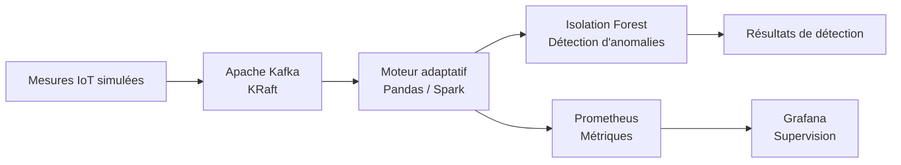
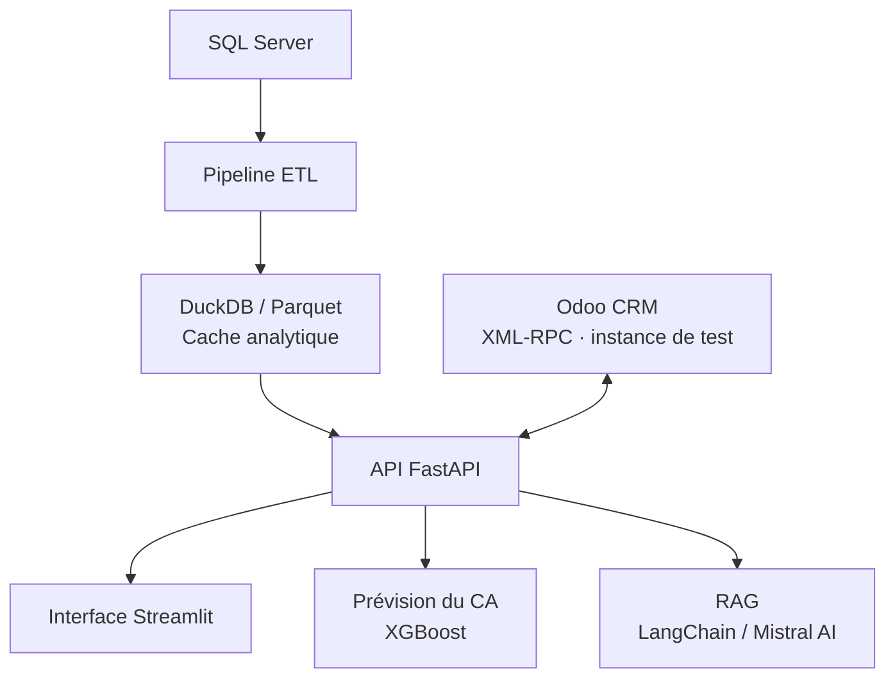
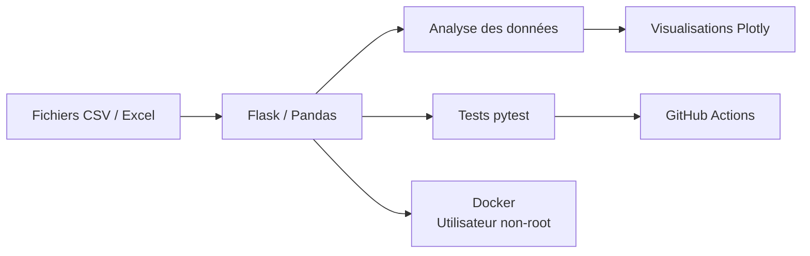

<h3>Bachelor Sciences des Données · Data Engineering · Machine Learning &amp; IA</h3>

Étudiante à l'<b>Université Cadi Ayyad</b>, je conçois des solutions de bout en bout : 
de la donnée brute au modèle exposé par une API, avec des tests, des conteneurs et un suivi des performances. 
Je m'intéresse particulièrement aux <b>pipelines fiables</b>, à la <b>qualité logicielle</b> et à l'<b>industrialisation des solutions data</b>.

  

<b>Ouverte aux stages et aux opportunités en data engineering, machine learning et IA.</b>

 

## Projets

<table>
<tr>

<td valign="top" width="33%">

<h3>01 · Smart Data Pipeline</h3>
<b>Pipeline IoT temps réel avec traitement adaptatif et supervision</b>
 Projet de fin d'études du DUT · équipe de trois · 2026

  
<b>Résultats clés (tests locaux)</b>
<ul>
<li>Environ <b>132 000</b> mesures simulées dans le flux</li>
<li><b>8</b> métriques de supervision Prometheus</li>
<li><b>6</b> conteneurs orchestrés avec Docker Compose</li>
<li>Latence inférieure à <b>500 ms</b> par message</li>
<li>Plus de <b>28 400</b> messages traités sans perte</li>
</ul>

<b>Stack</b> 
<code>Python</code> <code>Kafka</code> <code>Spark</code> <code>Pandas</code> <code>Isolation Forest</code> <code>Prometheus</code> <code>Grafana</code> <code>Docker Compose</code>

  

</td>

<td valign="top" width="33%">

<h3>02 · NexaDecide</h3>
<b>Plateforme d'aide à la décision intégrant data engineering et IA</b>
 Stage chez D-Business Consulting · avril – juin 2026

  
<b>Résultats clés (conditions des tests)</b>
<ul>
<li><b>443 154</b> enregistrements traités par le pipeline ETL</li>
<li>Cache lu en <b>moins de 100 ms</b> (contre 15 à 30 s en direct sur SQL Server)</li>
<li><b>9</b> endpoints FastAPI et <b>10</b> pages Streamlit</li>
<li>Prévision du CA : <b>MAPE de 8,9 %</b> (XGBoost, données simulées)</li>
<li>Recommandations Mistral AI, LangChain et RAG</li>
<li>Intégration Odoo CRM via XML-RPC (instance de test)</li>
</ul>

<b>Stack</b> 
<code>Python</code> <code>FastAPI</code> <code>Streamlit</code> <code>DuckDB</code> <code>Parquet</code> <code>XGBoost</code> <code>LangChain</code> <code>Mistral AI</code>

  

</td>

<td valign="top" width="33%">

<h3>03 · GraphGen</h3>
<b>Application web d'analyse exploratoire de fichiers CSV et Excel</b>
 Projet en binôme avec <a href="https://github.com/Chaymae-El-Bahloul">Chaymae El Bahloul</a>

  
<b>Résultats clés</b>
<ul>
<li>Visualisations interactives avec <b>Plotly</b></li>
<li><b>12</b> tests pytest</li>
<li>Linting avec ruff</li>
<li>Intégration continue via GitHub Actions</li>
<li>Conteneur Docker <b>non-root</b> avec healthcheck</li>
</ul>

<b>Stack</b> 
<code>Python</code> <code>Flask</code> <code>Pandas</code> <code>Plotly</code> <code>pytest</code> <code>ruff</code> <code>GitHub Actions</code> <code>Docker</code>

  

</td>

</tr>
</table>

<i>Note sur les résultats : les métriques chiffrées proviennent de tests locaux ou de données simulées. Elles ne constituent pas des garanties de performance en production.</i>

 

### Architectures

<b>01 · Smart Data Pipeline</b> — flux IoT temps réel, détection d'anomalies et supervision

<b>02 · NexaDecide</b> — de SQL Server à l'API, la prévision et le RAG

<b>03 · GraphGen</b> — analyse de fichiers, tests et CI/CD

 

## Stack technique

| Domaine | Technologies |
|---|---|
| **Langages** |     |
| **Data Engineering** |         |
| **Machine Learning & IA** |       |
| **API & applications** |     |
| **Qualité & exploitation** |         |

<i>Technologies utilisées dans des contextes variés, avec des niveaux de pratique différents.</i>

 

## Parcours

| Période | Intitulé | Détail |
|---|---|---|
| **2026 – en cours** | **Bachelor Sciences des Données** | EST Kelâa des Sraghna (Université Cadi Ayyad) |
| **2024 – 2026** | **DUT Ingénierie des Données** | EST Kelâa des Sraghna |
| **2025 – 2026** | **Trois stages** | Développement d'applications (été 2025) · Data engineering et IA (avril – juin 2026) · Data et BI (juin – août 2026) |
| **2024** | **Baccalauréat scientifique** | Mention Très Bien |

 

<table>
<tr>

<td valign="top" width="50%">

<h3>En cours d'exploration</h3>
Sujets que j'apprends activement, pas encore pratiqués en production.
<ul>
<li>Suivi d'expériences et versioning des modèles avec <b>MLflow</b></li>
<li>Détection de dérive des données et des modèles</li>
<li><b>CI/CD</b> appliqué au machine learning</li>
<li><b>Kubernetes</b>, Linux et Bash</li>
</ul>

</td>

<td valign="top" width="50%">

<h3>Me contacter</h3>
Ouverte aux stages et aux opportunités en data engineering, machine learning et IA.
  

</td>

</tr>
</table>

