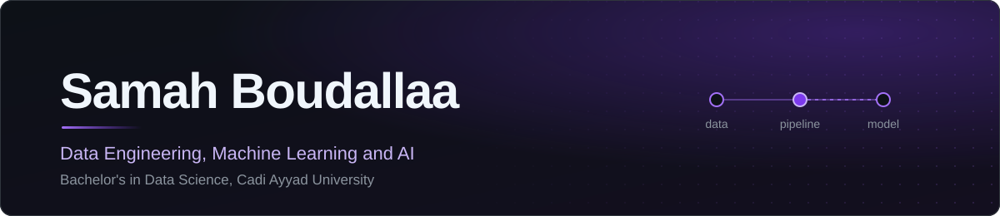
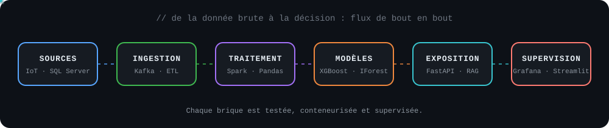
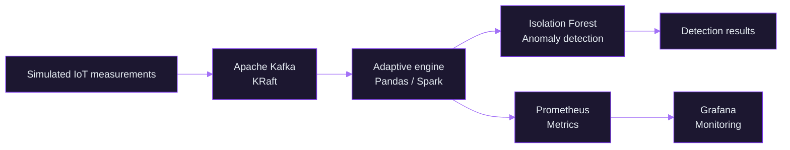
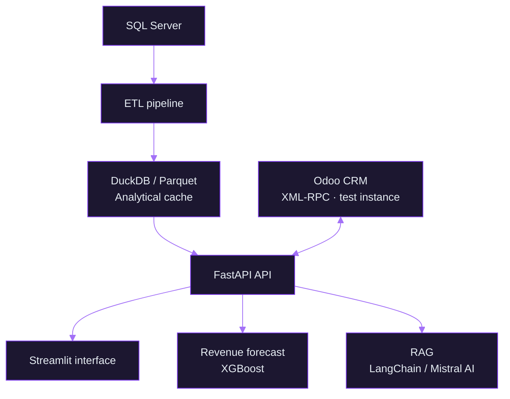
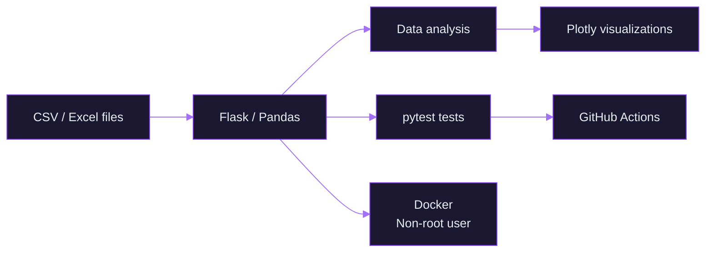
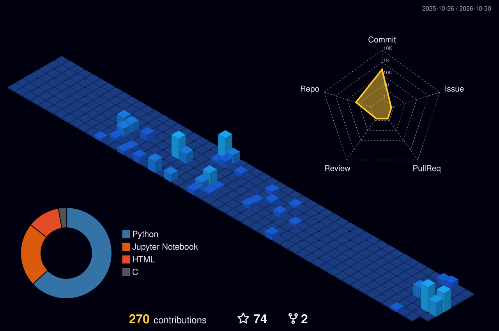
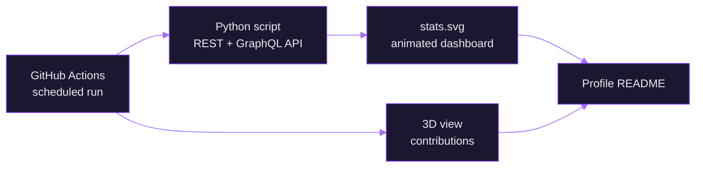
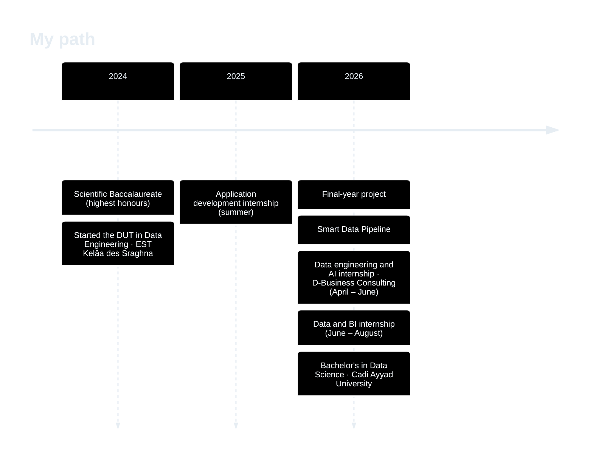

<p align="right"><sub><b>EN</b> · <a href="./README.fr.md" title="Lire en français">FR</a></sub></p>



<div align="center">

<br/>

<b>Data Science student · Data Engineering, Machine Learning and AI</b><br/>
<sub>Morocco · open to internships in data engineering, machine learning and AI</sub>

<br/><br/>

<a href="https://samah-boudallaa.github.io/"></a>
<a href="https://www.linkedin.com/in/samah-boudallaa-92409a329"></a>
<a href="mailto:samahboudallaa@gmail.com"></a>
<a href="https://github.com/Samah-boudallaa"></a>

<br/><br/>

<sub><a href="#projects">Projects</a> &nbsp;·&nbsp; <a href="#architectures">Architectures</a> &nbsp;·&nbsp; <a href="#technical-stack">Stack</a> &nbsp;·&nbsp; <a href="#github-activity">Activity</a> &nbsp;·&nbsp; <a href="#background">Background</a> &nbsp;·&nbsp; <a href="#contact">Contact</a></sub>

</div>

<br/>

## In 30 seconds

Bachelor's student in **Data Science** (Sciences des Données) at EST Kelâa des Sraghna (Cadi Ayyad University), after a **DUT in Data Engineering** (Ingénierie des Données). I am interested in **data engineering**, **machine learning**, **AI** and the **industrialisation of data pipelines**.

> From raw data to a model served through an API, with tests, containers and monitoring.

<table>
<tr>
<td valign="top" width="33%">
<b>What I am looking for</b><br/>
An internship in <b>data engineering</b>, <b>machine learning</b> or <b>AI</b>, where data actually ends up in production.
</td>
<td valign="top" width="33%">
<b>What I bring</b><br/>
Streaming and batch pipelines, APIs, tests, CI and containers: all of it <b>reproducible</b>.
</td>
<td valign="top" width="33%">
<b>Verify it yourself</b><br/>
Every project below has a public repository, an architecture diagram and figures that come from local tests.
</td>
</tr>
</table>

<br/>

<div align="center">

</div>

<br/>

## Projects

<table>
<tr>
<td valign="top" width="46%">

<h3>Smart Data Pipeline</h3>
<b>Real-time IoT pipeline with adaptive processing and monitoring</b>
<br/><sub>DUT final-year project · team of three · 2026</sub>

<br/><br/>
<code>Python</code> <code>Kafka</code> <code>Spark</code> <code>Pandas</code> <code>Isolation Forest</code> <code>Prometheus</code> <code>Grafana</code> <code>Docker Compose</code>

<br/><br/>
<b><a href="https://github.com/Samah-boudallaa/smart-data-pipeline-pfe">View the repository</a></b>
<br/>


</td>
<td valign="top" width="54%">

<b>Key results (local tests)</b>
<ul>
<li>About <b>132,000</b> simulated measurements in the stream</li>
<li><b>8</b> Prometheus monitoring metrics</li>
<li><b>6</b> containers orchestrated with Docker Compose</li>
<li>Latency under <b>500 ms</b> per message</li>
<li>More than <b>28,400</b> messages processed without loss</li>
</ul>

</td>
</tr>
</table>

<br/>

<table>
<tr>
<td valign="top" width="46%">

<h3>NexaDecide</h3>
<b>Decision-support platform combining data engineering and AI</b>
<br/><sub>Internship at D-Business Consulting · April – June 2026</sub>

<br/><br/>
<code>Python</code> <code>FastAPI</code> <code>Streamlit</code> <code>DuckDB</code> <code>Parquet</code> <code>XGBoost</code> <code>LangChain</code> <code>Mistral AI</code>

<br/><br/>
<b><a href="https://github.com/Samah-boudallaa/nexadecide-decision-system">View the repository</a></b>
<br/>


</td>
<td valign="top" width="54%">

<b>Key results (test conditions)</b>
<ul>
<li><b>443,154</b> records processed by the ETL pipeline</li>
<li>Cache read in <b>under 100 ms</b> (versus 15 to 30 s directly on SQL Server)</li>
<li><b>9</b> FastAPI endpoints and <b>10</b> Streamlit pages</li>
<li>Revenue forecast: <b>8.9% MAPE</b> (XGBoost, simulated data)</li>
<li>Recommendations with Mistral AI, LangChain and RAG</li>
<li>Odoo CRM integration via XML-RPC (test instance)</li>
</ul>

</td>
</tr>
</table>

<br/>

<table>
<tr>
<td valign="top" width="46%">

<h3>GraphGen</h3>
<b>Web application for exploratory analysis of CSV and Excel files</b>
<br/><sub>Pair project with <a href="https://github.com/Chaymae-El-Bahloul">Chaymae El Bahloul</a></sub>

<br/><br/>
<code>Python</code> <code>Flask</code> <code>Pandas</code> <code>Plotly</code> <code>pytest</code> <code>ruff</code> <code>GitHub Actions</code> <code>Docker</code>

<br/><br/>
<b><a href="https://github.com/Samah-boudallaa/GraphGen">View the repository</a></b>
<br/>
<a href="https://github.com/Samah-boudallaa/GraphGen/actions/workflows/ci.yml"></a>

</td>
<td valign="top" width="54%">

<b>Key results</b>
<ul>
<li>Interactive visualizations with <b>Plotly</b></li>
<li><b>12</b> pytest tests</li>
<li>Linting with ruff</li>
<li>Continuous integration via GitHub Actions</li>
<li><b>Non-root</b> Docker container with healthcheck</li>
</ul>

</td>
</tr>
</table>

<sub><i>Note on results: the figures come from local tests or simulated data. They are not production performance guarantees.</i></sub>

<br/>

<details>
<summary><b>Why these projects? What they show about how I work</b></summary>

<br/>

| Project | Skill demonstrated | Evidence in the repository |
|---|---|---|
| **Smart Data Pipeline** | Designing an observable real-time flow | Kafka, Prometheus metrics, Grafana dashboards, `docker-compose.yml` |
| **NexaDecide** | Connecting data, models and business use | ETL, DuckDB/Parquet cache, FastAPI API, forecasting, RAG |
| **GraphGen** | Shipping clean, reproducible software | pytest tests, ruff, GitHub Actions CI, non-root Docker image |

</details>

<br/>

## Architectures

<sub>Click a project to expand its diagram.</sub>

<details>
<summary><b>Smart Data Pipeline</b>, real-time IoT flow, anomaly detection and monitoring</summary>



</details>

<details>
<summary><b>NexaDecide</b>, from SQL Server to the API, forecasting and RAG</summary>



</details>

<details>
<summary><b>GraphGen</b>, file analysis, tests and CI/CD</summary>



</details>

<br/>

## Technical stack

| Area | Technologies |
|---|---|
| **Languages** |     |
| **Data Engineering** |         |
| **Machine Learning and AI** |       |
| **APIs and applications** |     |
| **Quality and operations** |         |

<sub><i>Technologies used in varied contexts, with different levels of practice.</i></sub>

<br/>

## GitHub activity

This dashboard is not a third-party widget: it is **generated every day by my own pipeline** (Python script + GitHub Actions) from the GitHub API. A data pipeline, applied to my own profile.

<div align="center">



<sub><i>Part of my internship work lives in private repositories: depending on the token used, it is counted separately or missing from these charts.<br/>The GitHub profile page itself adds up public and private contributions.</i></sub>

</div>

<details>
<summary><b>3D view of contributions</b></summary>

<br/>

<div align="center">

<br/>
<sub><i>Generated by GitHub Actions with the open-source github-profile-3d-contrib action.</i></sub>
</div>

</details>

<details>
<summary><b>How this dashboard is produced</b></summary>

<br/>

Nothing is copied by hand: a GitHub Actions workflow queries the GitHub API (REST and GraphQL), a Python script computes the indicators and writes animated SVG files, and the result is committed automatically.



</details>

<br/>

## Background

| Period | Title | Details |
|---|---|---|
| **2026 – present** | **Bachelor's in Data Science** | EST Kelâa des Sraghna (Cadi Ayyad University) |
| **2024 – 2026** | **DUT in Data Engineering** | EST Kelâa des Sraghna |
| **2025 – 2026** | **Three internships** | Application development (summer 2025) · Data engineering and AI (April – June 2026) · Data and BI (June – August 2026) |
| **2024** | **Scientific Baccalaureate** | Highest honours (Mention Très Bien) |

<details>
<summary><b>View the timeline</b></summary>



</details>

<br/>

## Currently exploring

<sub>Topics I am actively learning, not yet practised in production.</sub>

- Experiment tracking and model versioning with **MLflow**
- Data and model drift detection
- **CI/CD** applied to machine learning
- **Kubernetes**, Linux and Bash

<br/>

## Contact

Open to internships and opportunities in data engineering, machine learning and AI.

<table>
<tr><td><b>Portfolio</b></td><td><a href="https://samah-boudallaa.github.io/">samah-boudallaa.github.io</a></td></tr>
<tr><td><b>LinkedIn</b></td><td><a href="https://www.linkedin.com/in/samah-boudallaa-92409a329">Samah Boudallaa</a></td></tr>
<tr><td><b>E-mail</b></td><td><a href="mailto:samahboudallaa@gmail.com">samahboudallaa@gmail.com</a></td></tr>
<tr><td><b>GitHub</b></td><td><a href="https://github.com/Samah-boudallaa">Samah-boudallaa</a></td></tr>
</table>

<br/>

<details>
<summary><sub>docker compose up -d</sub></summary>

<br/>

```bash
$ docker compose up -d
[+] Running 6/6
 Container kafka         Started
 Container spark         Started
 Container anomaly-ml    Started
 Container prometheus    Started
 Container grafana       Started
 Container samah         Started   # hire me
```

</details>

<br/>

<div align="center">


<br/>

Thanks for visiting. A question, a project, an internship: get in touch.

<sub><a href="https://samah-boudallaa.github.io/">Portfolio</a> · <a href="https://www.linkedin.com/in/samah-boudallaa-92409a329">LinkedIn</a> · <a href="mailto:samahboudallaa@gmail.com">E-mail</a> · <a href="https://github.com/Samah-boudallaa">GitHub</a></sub>

<br/>

<sub><b>EN</b> · <a href="./README.fr.md" title="Lire en français">FR</a></sub>

</div>
